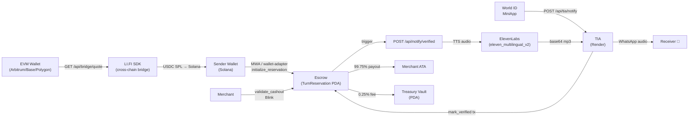

# Remesa LiquidezIA

## Qué es

TIA es una capa de inteligencia para fintechs del corredor EE. UU.–México: compara rutas USD→MXN, entrega cotizaciones verificables y emite recibos firmados anclados en IPFS (Nirium Audit Trail). **TIA compara y cotiza; no ejecuta pagos, no custodia fondos ni sustituye un SPEI.**

## Demo

- **Sitio en vivo:** [https://stellar.holatia.app](https://stellar.holatia.app) — demo interactiva de comparación de rutas
- **API x402 (mainnet):** [https://x402.holatia.app](https://x402.holatia.app) — pagos por llamada en USDC sobre Stellar `pubnet`. Ver tabla de precios abajo.

## Cómo se usa

### (a) Demo web interactiva

Abre [stellar.holatia.app](https://stellar.holatia.app) y solicita una comparación de rutas USD→MXN. El sitio muestra la estimación en vivo con recibo IPFS.

### (b) Llamada pagada desde un agente (x402 sobre Stellar mainnet)

La API cobra por llamada con x402 (HTTP 402) en USDC sobre Stellar mainnet. El pago es automático; no necesitas API key.

- **Guía completa:** [docs/agents/README.md](docs/agents/README.md)
- **Ejemplo ejecutable:** [examples/agent-client/](examples/agent-client/)

| Endpoint | Precio |
|----------|--------|
| `GET /v1/quote` | $0.10 USDC |
| `GET /v1/route?amount=USD` | $0.25 USDC |
| `POST /v1/alert` | $0.10 USDC |
| `GET /health` | gratis |

### (c) Desarrollo local

**Backend:**

```bash
cd backend
npm install
npm test
npm run dev  # servidor local en puerto 3100
```

**Contrato Soroban (Stellar escrow PoC):**

```bash
cd contracts/remesa-tia-stellar
cargo test
```

## Qué hay en v1.0.0

### Live en mainnet

- **API x402 pagada en USDC** sobre Stellar `pubnet` (`x402.holatia.app`) — `GET /v1/quote`, `GET /v1/route`, `POST /v1/alert`
- **Recibos verificables** firmados con ed25519 y anclados en IPFS (Nirium Audit Trail) — endpoint `GET /v1/receipt/:cid` (gratis), función `register_receipt` (testnet)
- **Sitio público** [stellar.holatia.app](https://stellar.holatia.app) desplegado en producción

### Sandbox / testnet

- **Integración Etherfuse** en SANDBOX: cotización 100 USDC → 1,959.26 MXN, costo total 0.17% — **sandbox únicamente, no ejecuta órdenes reales**
- **Escrow Soroban** desplegado en testnet con `settle_with_receipt`, `open_dispute`, `resolve_dispute` — PR [#43](https://github.com/Edgadafi/remesa-liquidez/pull/43) pendiente de merge

**Importante:** TIA no tiene clientes de pago. Es un prototipo de inteligencia y trazabilidad para fintechs; no ejecuta remesas, no custodia fondos de terceros ni sustituye un SPEI.

## Piloto de calibración (30 días, 3 cupos de founder)

Meta de cierre 2026: **3 fintechs en un piloto de calibración de 30 días**. Durante el piloto: condiciones comerciales acordadas con cada fintech. Fuera del piloto: cobro por llamada vía x402. Solicitudes en [stellar.holatia.app](https://stellar.holatia.app).

## TIA on Stellar — live links (verifiable)

- **Live site:** https://stellar.holatia.app (source: [`site/`](site/))
- **API (primary):** https://x402.holatia.app — x402 `exact` on `stellar:pubnet`. Contract: [docs/tia-openapi.yaml](docs/tia-openapi.yaml). License: [MIT](LICENSE).
- **Testnet host (handshake):** https://remesa-tia-testnet.vercel.app — `stellar:testnet`

  | Endpoint | Price |
  |---|---|
  | `GET /v1/quote` | $0.10 USDC |
  | `GET /v1/route?amount=USD` | $0.25 USDC |
  | `POST /v1/alert` | $0.10 USDC |
  | `GET /health` | free |

- **Soroban escrow contract (mainnet, v0_b2):** `CBCWBOZBCKJ4FSCMQ2OJUI3UDDNT7QSPURTSAELKESPY6D7DUA22M5MP` — [stellar.expert](https://stellar.expert/explorer/public/contract/CBCWBOZBCKJ4FSCMQ2OJUI3UDDNT7QSPURTSAELKESPY6D7DUA22M5MP). Esta dirección tiene fallas conocidas. Ver [Seguridad del escrow](#seguridad-del-escrow).
- **First paid mainnet call (tx):** [b5fc310f…5695e0d](https://stellar.expert/explorer/public/tx/b5fc310f086d3e4e170384fec0ccd1485c9b348559a12f61aa1ec9f2b5695e0d) — replaying the same payment returned `409` (replay protection).

---

> **Building an AI agent?** The TIA backend sells live USD/MXN intelligence paid per request with x402 on Stellar mainnet — no API key, ~$0.10 USDC per call. Guide + copy-paste TypeScript client: [docs/agents/README.md](docs/agents/README.md) · runnable example: [examples/agent-client/](examples/agent-client/)

> **Seguridad:** el blindaje por capas del rail x402 (claves, contrato, facilitador, servidor, agente cliente, monitoreo) está documentado en [SECURITY.md](SECURITY.md). El escrow on-chain es una prueba de concepto; las fallas de la versión desplegada están en [Seguridad del escrow](#seguridad-del-escrow).

## Seguridad del escrow

El escrow (Soroban y el programa Anchor) es una **prueba de concepto**. No uses estos contratos para custodiar fondos de terceros.

La versión desplegada en Stellar mainnet, `CBCWBOZBCKJ4FSCMQ2OJUI3UDDNT7QSPURTSAELKESPY6D7DUA22M5MP`, tiene fallas conocidas. Las reportó **KupiaSec** y quedaron confirmadas en el código de esa versión:

- cualquier comercio registrado podía cobrar una reserva verificada;
- el remitente podía marcar como verificada su propia reserva;
- el cobro no exigía la firma de quien recibe el efectivo;
- no había forma de dar de baja a un comercio;
- el identificador de la reserva lo elegía el primero que llegara;
- las entradas persistentes no extendían su TTL.

Ese contrato **no es actualizable**. El arreglo está en este repositorio (`version()` `v0_c2` en Soroban, el mismo flujo en Solana) y hace falta un despliegue nuevo. Hasta ese despliegue, `CBCWBOZBCKJ4FSCMQ2OJUI3UDDNT7QSPURTSAELKESPY6D7DUA22M5MP` no debe usarse con fondos de terceros.

El ciclo de una reserva es crear, verificar, y una sola salida:

1. `initialize_reservation` bloquea el monto y fija `expires_at` (timestamp del ledger) a partir de `expiry_seconds`. En las dos cadenas la ventana va de 1 hora (`MIN_EXPIRY_SECONDS = 3600`) a 30 días. Fuera de rango, Soroban falla con `BadExpiry` y Solana con `InvalidExpiry`. No se mueve el USDC.
2. `mark_verified` lo firma el admin o el verifier. El remitente no puede verificar la suya.
3. Antes de `expires_at`, el comercio asignado y el receptor firman `validate_cashout`. El comercio recibe el 99.75% y el tesoro el 0.25%.
4. Desde `expires_at`, `validate_cashout` falla (`Expired` en Soroban, `ReservationExpired` en Solana) y `refund_expired` devuelve el 100% al remitente, sin fee. Lo firma el remitente, o el admin si no es el comercio ni el receptor. El comercio y el receptor no pueden.

El cobro y el reembolso no se traslapan. En el instante del vencimiento el cobro ya está cerrado y solo queda el reembolso. Una reserva cobrada o ya reembolsada no se mueve otra vez. Una reserva verificada tampoco se cancela con `cancel_reservation`. El comercio no debe entregar efectivo antes de que `validate_cashout` confirme.

En Solana el mínimo de una hora está en el build de despliegue. El feature de Cargo `test-short-expiry` lo baja a 1 segundo para que la suite de Anchor pueda esperar el reloj del validator. Un build de despliegue no debe usar ese feature: `anchor build` a secas, sin `--features test-short-expiry`.

Crédito del reporte: KupiaSec.

---

## El problema

En remesas y pagos locales de LATAM, tres cosas fallan sistemáticamente:

- **Confianza y orden** — no hay regla pública sobre quién cobra cuándo en un grupo de comercios o rutas recurrentes.
- **Comisiones opacas** — el fee es una promesa off-chain, nunca verificable por el receptor.
- **Integración práctica** — el receptor tiene que abrir una app específica; el comerciante no puede simplemente escanear un código desde su wallet.

**Remesa LiquidezIA** resuelve esto con un contrato Anchor que hace cumplir las reglas on-chain: turno reservado, verificación opcional (World ID), cashout con split de fee determinístico, y una capa HTTPS/Actions para que cualquier wallet pueda ejecutar el flujo.

---

## Cómo funciona



1. **Sender** bloquea SPL tokens en un vault PDA con `initialize_reservation`.
2. **World ID** valida la identidad del receptor; el backend TIA firma `mark_verified` on-chain.
3. **Merchant** cobra solo si es el comercio asignado a la reserva y el vencimiento no llegó. `validate_cashout` lo firman el comercio y el receptor (prueba de que recibió el efectivo). El comercio recibe el 99.75%; el 0.25% va al tesoro del protocolo.
4. Si el receptor no firma, los fondos no se quedan atrapados. Al llegar `expires_at` el cobro falla y `refund_expired` devuelve el 100% al remitente. Esas dos salidas no conviven: ver [Seguridad del escrow](#seguridad-del-escrow).
5. El admin puede drenar el tesoro con `withdraw_treasury` (admin-only).

---

## Stack tecnológico

| Capa | Tecnología |
|---|---|
| Contrato | Rust · Anchor `0.32` |
| Cliente TS | `@coral-xyz/anchor` · `@solana/web3.js` |
| Frontend / Actions | Next.js 14 · Vercel · `@solana/actions` |
| Backend IA | Node.js · Render · ElevenLabs · World ID |
| Red | Solana **devnet** (program ID abajo) |
| Bridge cross-chain | **LI.FI SDK** — USDC desde Arbitrum, Base, Polygon → Solana |
| Notificación TTS | **ElevenLabs** `eleven_multilingual_v2` — audio "dinero listo" vía TIA/WhatsApp |
| Firma móvil | **Mobile Wallet Adapter (MWA)** — Android Intent (Phantom, Solflare, Backpack) |

---

## Estructura del monorepo

```
remesa-liquidez/
├── programs/          # Anchor (Solana — production pilot)
│   └── remesa-liquidez/src/
│       ├── lib.rs                  # entry point — 8 instrucciones
│       └── instructions/           # módulo por instrucción
├── contracts/
│   └── remesa-tia-stellar/        # Soroban escrow (Stellar — PoC scaffold)
├── web/               # Next.js + Solana Actions → Vercel
│   ├── app/
│   │   ├── page.tsx                # Sender App (MWA + wallet-adapter)
│   │   ├── actions.json/route.ts   # manifest Blinks
│   │   └── api/
│   │       ├── actions/
│   │       │   ├── verify/route.ts     # mark_verified Blink
│   │       │   └── cashout/route.ts    # validate_cashout Blink
│   │       ├── bridge/
│   │       │   └── quote/route.ts      # GET — LI.FI bridge quote
│   │       └── notify/
│   │           └── verified/route.ts   # POST — ElevenLabs TTS + WhatsApp
│   ├── components/
│   │   ├── SenderApp.tsx           # UI principal: connect → reserve → verify
│   │   ├── ReserveForm.tsx         # formulario initialize_reservation
│   │   ├── VerifyButton.tsx        # botón mark_verified (MWA sign)
│   │   └── ConnectButton.tsx       # botón connect wallet (MWA / modal)
│   ├── providers/
│   │   └── WalletProvider.tsx      # MWA + Phantom + Solflare + Backpack
│   ├── lib/
│   │   ├── chain/                  # dual-chain adapters (Solana + Stellar)
│   │   ├── anchor.ts               # program client (read-only)
│   │   ├── pdas.ts                 # derivación de PDAs
│   │   ├── fx.ts                   # Bitso MXN estimate (shared)
│   │   ├── instructions.ts         # buildMarkVerifiedIx helper
│   │   ├── lifi.ts                 # LI.FI SDK — quoteBridgeToSolana()
│   │   └── elevenlabs.ts           # TTS — textToSpeech() + scripts TIA
│   ├── idl/                        # IDL JSON commiteado
│   └── types/                      # tipos TS generados por Anchor
├── backend/           # Backend TIA — POST /api/tia/notify · ver backend/README.md
│   └── docs/accelerator/week-01/  # VPC, founder story, entrevistas (Bridge Sem 1)
├── client/
│   ├── index.ts       # Solana ix builders
│   └── stellar/       # Stellar client stub
├── docs/
│   └── dual-chain-decision.md     # kill/win criteria Solana vs Stellar
├── scripts/           # e2e:devnet · e2e:stellar:testnet · register merchants
├── tests/             # Anchor tests (mocha/chai)
├── migrations/        # initialize_config bootstrap
├── .env.example       # Vars unificadas (fuente de verdad)
└── Anchor.toml
```

---

## Inicio rápido

### Prerrequisitos

- Rust + Anchor CLI `0.32`
- Solana CLI (cluster devnet)
- Node.js ≥ 20 · Yarn

### Instalación

```bash
# Dependencias raíz (Anchor + scripts)
yarn install

# Dependencias del frontend
cd web && npm install && cd ..
```

### Variables de entorno

```bash
cp .env.example .env
# Editar .env con tus valores reales
npm run sync-env          # propaga a web/.env (y backend/.env cuando exista)
```

### Compilar y testear el programa

```bash
# Despliegue. No pases --features test-short-expiry.
anchor build

# Suite. Ese feature baja el mínimo de expiry a 1 segundo.
anchor test -- --features test-short-expiry
```

### E2E en devnet (mint → reserve → verify → cashout)

```bash
npm run e2e:devnet
```

El script imprime las tx signatures y el split fee verificado al final.

### Frontend local

```bash
cd web && npm run dev
# → http://localhost:3000
```

### Deploy a Vercel

```bash
cd web && vercel deploy --prod --yes --scope <tu-scope>
```

---

## Endpoints en producción

| Recurso | URL |
|---|---|
| Demo / Landing (Sender App) | `https://web-coral-pi-66.vercel.app` |
| Actions manifest | `https://web-coral-pi-66.vercel.app/actions.json` |
| Verify Action | `https://web-coral-pi-66.vercel.app/api/actions/verify?pda=<PDA>` |
| Cashout Action | `https://web-coral-pi-66.vercel.app/api/actions/cashout?pda=<PDA>` |
| Bridge quote (LI.FI, free) | `https://web-coral-pi-66.vercel.app/api/bridge/quote` |
| Premium bridge quote (x402) | `https://remesa-tia-backend.vercel.app/premium/bridge-quote` |
| Premium FX tick (x402) | `https://remesa-tia-backend.vercel.app/premium/fx` |
| Notify verified (ElevenLabs) | `https://web-coral-pi-66.vercel.app/api/notify/verified` |
| Backend TIA | `https://remesa-tia-backend.vercel.app` |
| Stores (liquidez) | `https://remesa-blink-backend.onrender.com/api/pricing/stores` |

#### Bridge quote (free — UI TIA)

```
GET /api/bridge/quote?fromAddress=<EVM_WALLET>&toAddress=<SOL_WALLET>&fromAmount=<RAW_USDC>&fromChain=ARB|BASE|POL
```

Devuelve `{ toAmount, toAmountMin, estimatedTime, tool, feeCostUsd, route }` — el campo `route` es el objeto completo de LI.FI listo para ejecutar con `executeRoute()`.

#### Premium API (x402 — USDC Stellar per call)

Pagada vía [Nirium x402](docs/nirium-x402-integration.md). Sin pago → **402 Payment Required**.

```
GET /premium/bridge-quote?...   # $0.02 — mismos query params que bridge quote free
GET /premium/fx                 # $0.01 — USD/MXN Bitso live
```

#### Notify verified

```
POST /api/notify/verified
Content-Type: application/json

{ "reservationPda": "<base58>", "txSignature": "<sig>", "receiverWA": "+521234567890", "amountUSDC": 10 }
```

Genera el audio TTS con ElevenLabs, lo envía como nota de voz a `receiverWA` vía TIA/WhatsApp, y devuelve `{ ok, audioBase64? }`.

### Blink URLs amigables

```
# Sender aprueba verificación World ID
https://web-coral-pi-66.vercel.app/verificar/<reservationPda>

# Receptor presenta al cajero para cobrar
https://web-coral-pi-66.vercel.app/remesa/<reservationPda>
```

---

## Sender App (Mobile Wallet Adapter)

La ruta `/` sirve la **Sender App**: UI para que quien envía la remesa conecte su wallet Solana y ejecute el flujo on-chain sin salir del browser ni de la wallet nativa.

### Flujo de dos pasos

1. **`initialize_reservation`** — el sender bloquea USDC en el vault PDA. Si el USDC está en una cadena EVM, primero solicita un quote via `GET /api/bridge/quote` para bridgear con LI.FI.
2. **`mark_verified`** — el sender firma la verificación. Tras confirmación on-chain, el frontend llama automáticamente a `POST /api/notify/verified`, que:
   - genera audio TTS con ElevenLabs ("¡Tu dinero está listo, TIA!")
   - envía la nota de voz al receptor vía TIA → WhatsApp

### Wallet signing por plataforma

| Plataforma | Mecanismo |
|---|---|
| Android (nativo) | **MWA** abre la wallet instalada vía Android Intent — Phantom, Solflare o Backpack Mobile |
| Desktop / web | Modal estándar `@solana/wallet-adapter-react-ui` — Phantom, Solflare, Backpack extensión |
| In-app browser | PhantomWalletAdapter detectado automáticamente |

El `WalletProvider` en `web/providers/WalletProvider.tsx` registra `SolanaMobileWalletAdapter` primero; en Android lo activa automáticamente si hay una wallet instalada, sin cambios en el código del componente.

---

## Program ID — devnet

```
Fprb6jTLfjXfZ6yuWzS7LVXxwVvPbPgPZiEqDEL9bRfj
```

[Ver en Solscan devnet →](https://solscan.io/account/Fprb6jTLfjXfZ6yuWzS7LVXxwVvPbPgPZiEqDEL9bRfj?cluster=devnet)

### Instrucciones del programa

| Instrucción | Quién firma | Efecto |
|---|---|---|
| `initialize_reservation` | Sender | Bloquea tokens en vault PDA |
| `mark_verified` | Sender | Vira `is_verified = true` |
| `validate_cashout` | Merchant | Libera vault; split 99.75/0.25 |
| `cancel_reservation` | Receiver (o Sender post-expiry) | Reembolso |
| `register_merchant` | Admin | Agrega a whitelist |
| `set_merchant_status` | Admin | Activa/desactiva merchant |
| `initialize_config` | Admin | Bootstrap Config PDA |
| `withdraw_treasury` | Admin | Drena fees acumulados |

---

## Verifiable Receipts (Niriumtober)

Starting with the Niriumtober integration, `/v1/route` responses include a **verifiable receipt** anchored to IPFS via [Nirium Audit Trail](https://nirium.xyz). Each receipt proves the quote data was delivered at a specific time, signed by TIA's dedicated receipt key.

### What gets anchored

Only the quote/route data, timestamp, and request ID — **no personal data, no IP addresses, no payment proofs**. The payload is:

```json
{
  "v": "tia-receipt-v1",
  "endpoint": "GET /v1/route",
  "requestId": "uuid",
  "timestamp": "2026-10-31T12:00:00.000Z",
  "data": { /* full route estimate */ }
}
```

The canonical JSON (sorted keys, no whitespace) is hashed (SHA-256), signed (ed25519 over `nirium-audit-v1:<hex>`), and anchored. The response includes:

```json
{
  "ok": true,
  "requestId": "...",
  "receipt": {
    "cid": "bafy...",
    "sha256": "abc123...",
    "signer": "GABC...",
    "anchoredAt": "2026-10-31T12:00:01.123Z"
  },
  /* ...route estimate */
}
```

If anchoring fails (network timeout, rate limit), `receipt` is `null` — the paid response is **never** broken.

### Verifying a receipt

1. **GET /v1/receipt/:cid** (free, no x402 charge):

```bash
curl https://x402.holatia.app/v1/receipt/bafy...
```

Returns:

```json
{
  "ok": true,
  "cid": "bafy...",
  "hash": "sha-256:abc123...",
  "gatewayUrl": "https://gateway.pinata.cloud/ipfs/bafy...",
  "verified": true,
  "verificationError": null,
  "document": { /* full IPFS doc */ }
}
```

2. **Manual verification**:

   - Fetch the IPFS document from the gateway URL
   - Check `content_sha256` matches the receipt hash
   - Verify the ed25519 signature in `agent.signature` against `agent.key` and `nirium-audit-v1:<hash>`
   - Confirm `agent.key` matches the `signer` from the receipt

### Environment setup

```bash
# Generate a NEW Stellar keypair for signing (never reuse STELLAR_PAY_TO)
npm install -g @stellar/stellar-cli
stellar keys generate receipt --network testnet

# Set in .env (backend/)
TIA_RECEIPT_SECRET=S...        # Stellar secret key from above
NIRIUM_NETWORK=testnet          # or mainnet/pubnet
NIRIUM_API_KEY=                 # optional, defaults to "demo"
```

**First mainnet anchor**: Set `NIRIUM_NETWORK=mainnet` and restart. The first `/v1/route` call after that will anchor to mainnet Nirium.

### Tag: niriumtober

All receipts are tagged `niriumtober` for the Nirium Mainnet Builder category. This tag is visible in the IPFS document but does not appear in the `/v1/route` response.

---

## Variables de entorno

Copiar `.env.example` → `.env` y rellenar:

| Variable | Necesaria en | Descripción |
|---|---|---|
| `SOLANA_CLUSTER` | web · backend | `devnet` o `mainnet-beta` |
| `SOLANA_RPC_URL` | web · backend | URL del RPC HTTPS |
| `PROGRAM_ID` | backend | Program ID del contrato |
| `SENDER_AUTHORITY_SECRET_KEY` | **solo backend** | Keypair JSON (64 bytes) que firma `mark_verified` |
| `BLINK_BASE_URL` | backend | Base URL de Vercel para construir Blink URLs |
| `NEXT_PUBLIC_BLINK_BASE_URL` | web | Igual que arriba, expuesta al browser |
| `RENDER_BACKEND_URL` | **web** (proyecto Vercel `web` / web-coral-pi-66) | URL del backend TIA: `https://remesa-tia-backend.vercel.app` |
| `ELEVENLABS_API_KEY` | **solo web (server-side)** | API key de ElevenLabs — nunca `NEXT_PUBLIC_` |
| `ELEVENLABS_VOICE_ID` | web | Voice ID (default: `EXAVITQu4vr4xnSDxMaL` — Sarah ES) |
| `WORLD_ID_APP_ID` | backend | App ID de World ID |
| `NEXT_PUBLIC_USDC_MINT` | web | USDC mint devnet (default: `4zMMC9srt5Ri5X14GAgXhaHii3GnPAEERYPJgZJDncDU`) |

> `SENDER_AUTHORITY_SECRET_KEY`, `ELEVENLABS_API_KEY` y `STELLAR_TESTNET_SECRET` **nunca** van a Vercel con prefijo `NEXT_PUBLIC_` ni se commitean. `STELLAR_TESTNET_SECRET` es solo local (`x402:smoke`): en el dashboard cualquiera con acceso firma pagos.

---

## Licencia

[MIT](LICENSE) — Copyright (c) 2026 Edgadafi.
